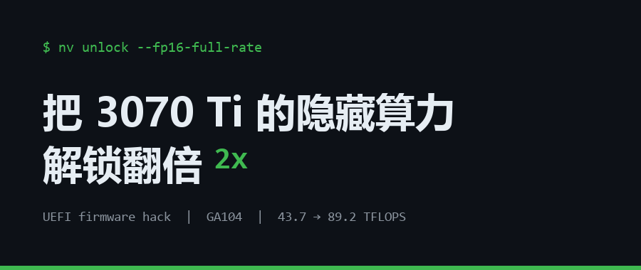
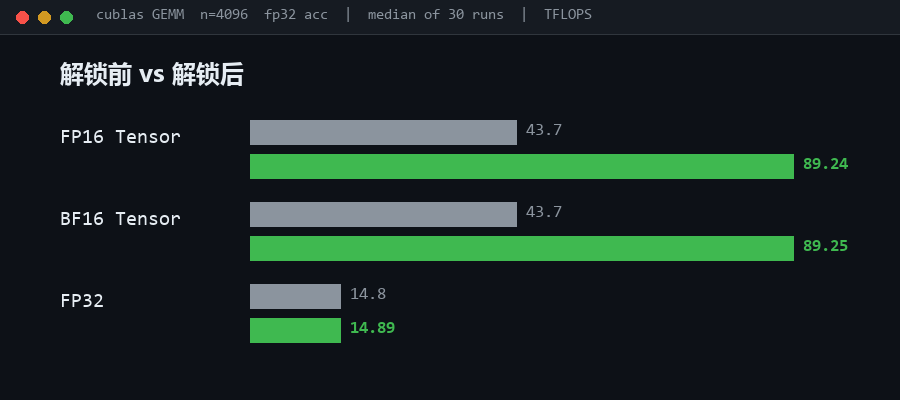
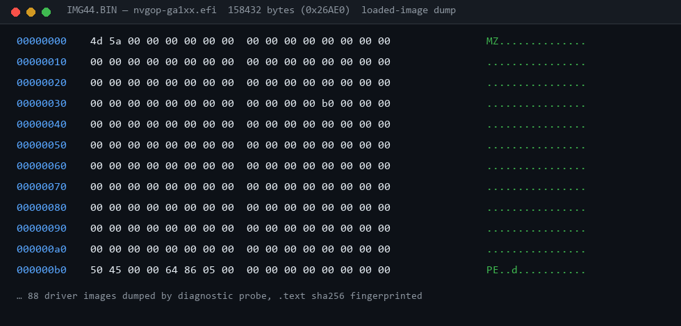
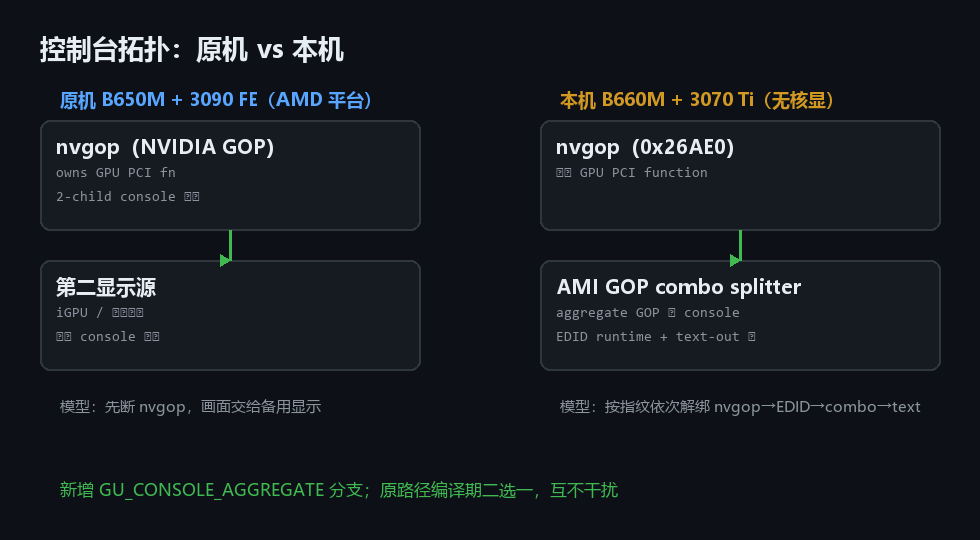
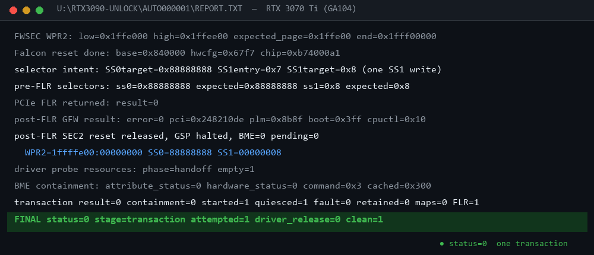
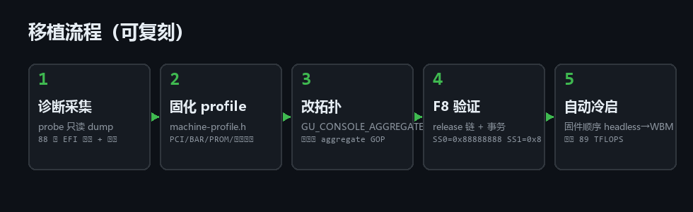

# 把 3070 Ti 的"隐藏算力"解锁翻倍：一次从 GitHub 到固件层的移植实录

> 副标题：反编译显卡固件、UEFI 里做手术、踩坑卡死 N 次之后，FP16 算力从 43 涨到 89 TFLOPS，代码已经提给上游等合并。



## 先说结果

我这台机器是 i7-12700F + 华硕 TUF B660M-E D4 + 微星 RTX 3070 Ti。折腾完之后的 cuBLAS GEMM 实测：

| 精度 | 解锁前 | 解锁后 |
|---|---:|---:|
| FP16 Tensor | ~43.7 TFLOPS | **89.24 TFLOPS** |
| BF16 Tensor | ~43.7 TFLOPS | **89.25 TFLOPS** |
| FP32 | 14.8 TFLOPS | 14.89 TFLOPS（不变） |



FP16/BF16 差不多正好翻倍——这不是超频，是把 NVIDIA 在驱动/固件层面对消费卡人为限制的 FP16 发射率，恢复到了它同核心专业卡的水平。

而且整个过程没有动 Windows 驱动一个字节：**解锁发生在开机进 Windows 之前，在 UEFI 固件阶段完成**。

这篇文章记录完整过程：找项目 → 发现只支持 Linux → 发现 Windows 移植但只支持一台机器 → 反编译显卡固件摸指纹 → 移植 → 无数次卡死重启 → 成功 → 给官方提 PR。

## 一、一切始于一个 Linux 项目

事情要从 GitHub 上的 [Zagitta/gpu-unlock](https://github.com/Zagitta/gpu-unlock) 说起。

这个项目的原理很多人都知道：NVIDIA Ampere 架构的消费级显卡（3090/3080/3070 全家），FP16/BF16 张量算力被砍到了大约一半，而同核心的专业卡（A 系列）没有这刀。这个开源模块通过向 GPU 写两个寄存器选择子（SS0/SS1）解锁这个限制。

问题是：**它是个 Linux 内核模块，Windows 用不了。**

评论区和 fork 里也有人问 Windows 怎么办。我继续翻，找到了一个更狠的项目：[impacifist/Windows-GPU-UNLOCK](https://github.com/impacifist/Windows-GPU-UNLOCK)。

它的思路非常硬核：既然 Windows 上没法动驱动，那就**在 Windows 启动之前动手**——写一个 UEFI 程序，在固件启动阶段、Windows 内核加载之前，先对显卡做完整个解锁事务（FWSEC 握手、WPR2 配置、PCIe FLR 复位、写选择子），然后链式加载 Windows Boot Manager。Windows 起来之后，看到的就是一块已经解锁的卡。

我当时心想：完美，下载下来刷进去就完事了。

然后我发现自己天真了。

## 二、这个"软件"只支持一台电脑

读完代码和文档，我意识到这个项目跟我理解的"软件"不一样。

它不是通用程序，而是**把开发者自己那台电脑的完整指纹写死在代码里的一次性手术方案**：

- GPU 的 PCI ID、子系统 ID、BDF 总线地址
- BAR0 物理地址、芯片 ID、显存寄存器值
- VBIOS（显卡 ROM）的 SHA-256 哈希
- 主板型号 + BIOS 版本号（精确到一个版本）
- 主板固件里每个 EFI 驱动的指纹：文件大小、入口点、版本号、`.text` 段的 SHA-256

以上任何一项对不上，程序就**拒绝执行**——这其实是好事，属于安全设计：写错寄存器是真会把卡写废的。

而它支持的机器是：ASUS B650M 主板（AMD 平台）+ RTX 3090 FE。

我是 ASUS B660M（Intel 平台）+ RTX 3070 Ti。**除了都是华硕，没有一样对得上。**

所以摆在我面前的活，不是"安装"，而是"移植"——而且这个项目自己写了：*changing constants alone is not a validated port*（光改常量不算移植成功）。

## 三、第一步：把显卡和主板的固件"翻个底朝天"

移植需要两样东西：

**1）显卡侧的固件资产。** 解锁事务需要 NVIDIA 驱动包里的 GSP 固件、boot 描述符等几个二进制 blob。这些从 NVIDIA 610.43.03 版 Linux 驱动源码包里提取，钉死版本（换版本哈希全变）。

**2）这台机器的固件指纹。** 这是真正的"反编译"环节。项目里有个 diagnostic probe（诊断探针）——一个只读的 UEFI 程序，编译进特殊构建里，启动时把整台机器的固件状态 dump 出来：

- PCI 配置空间、capability 链表、BAR 描述符
- 显卡的 VBIOS 哈希
- **固件里已加载的全部 88 个 EFI 驱动镜像**（每个 dump 成二进制文件，IMG00 到 IMG88）

跑完一次，ESP 分区上多了 88 个二进制 dump 和 35 万字节（350KB）的诊断日志。接下来就是体力活：在这些十六进制里大海捞针，找出几个关键驱动——

- `nvgop-ga1xx`：NVIDIA 自己的 GOP 显卡驱动，158432 字节（0x26AE0），是它"独占"着显卡
- AMI 的 EDID runtime 驱动：36864 字节
- AMI GOP combo splitter：负责把 GOP 画面聚合给控制台
- text-out splitter：文本输出

每一个都要算 .text 段哈希、记入口点、记版本号，写进 profile。找错一个，后面全白干。



## 四、最大的坑：我这颗 CPU 没有核显

原方案的控制台模型假设机器上有**第二个显示源**。但 12700F 的 F 后缀意味着：**没有核显**。整个启动过程的画面，只能靠 3070 Ti 自己输出。

这就引出了 AMI 主板一种很微妙的拓扑：nvgop 驱动独占显卡的同时，控制台画面是由 AMI 的 combo splitter 通过一个**聚合 GOP（aggregate GOP）**来显示的。我要做解锁，就得在不动显示的前提下，把 nvgop、EDID、combo splitter、text 这一整条链按指纹精确"解绑"。

原代码里没有这个路径，只能自己写。最后方案是新增了一个 `GU_CONSOLE_AGGREGATE` 拓扑分支，原机的路径原封不动保留，编译时用 `GU_PROFILE_B660M_3070TI` / `GU_PROFILE_B650M_3090FE` 二选一——两条路线共存，互不干扰，这也是后来 PR 能被接受的关键设计。



## 五、翻车实录：这几天我重启了几十次

说说真话，这活绝对不是一把过的：

- **F8 测试卡死**：测试启动方式是开机按 F8 手动选我的 EFI，一旦 release 链没解干净，直接黑屏卡死，只能强制重启
- **意外重启**：有一次不知道触发了什么，机器自己就重启了，然后 unlock 状态进不去，卡在启动页
- **反复改指纹重刷**：每改一处常量都要重新编译、刷 ESP、重启、按 F8、看日志，一轮十分钟
- **rebase 翻车**：官方仓库更新到 v0.3.1 后我同步代码，合出一个隐蔽 bug——上游把显示子设备计数改成了动态发现，而我新加的 aggregate 分支忘了设置 `Full.ChildCount=1`，导致动态循环跑 0 次，EDID/GOP 释放整个被跳过

这里必须夸一句原作者的设计：**所有失败路径都是 fail-safe**。ChildCount 那个 bug 不是把机器搞挂，而是在 `full-release-recheck` 这一步主动中止、一个寄存器都不写。几十次翻车没有一次是真砖——这就是"改错指纹就拒绝执行"的价值。



## 六、成的那一刻

修复之后再来一轮 F8：

```
post-FLR SEC2 reset released, GSP halted, BME=0 pending=0
  WPR2=1ffffe00:00000000 SS0=88888888 SS1=00000008
transaction result=0 containment=0 started=1 quiesced=1
  fault=0 retained=0 maps=0 FLR=1
FINAL status=0 stage=transaction attempted=1
  driver_release=0 clean=1
```

`SS0=0x88888888`、`SS1=0x8`——选择子写进去了，事务干净收尾，屏幕一闪，Windows 正常启动。

进系统第一件事，跑 GEMM：**FP16 89.24 TFLOPS**。之前锁定状态是 43.7。

然后把固件启动顺序改成 headless→Windows Boot Manager，之后**每次冷启动自动解锁**，不用任何操作。

## 七、回馈社区

既然移植做成了，按照官方的规矩整理证据提 PR：

- **PR #5** 提到 impacifist/Windows-GPU-UNLOCK：新增第二台硬件验证 profile，编译期选择，原机路径零改动
- **Issue #4**：按官方 compatibility report 模板提交了完整证据——EFI 二进制 SHA-256、净化后的事务日志、基准测试条件和方法
- **上游 Zagitta/gpu-unlock #32**：也发了一份兼容性报告，证明 GA104 选择子语义在 3070 Ti 上同样成立

有意思的是，PR 里要求的"可复现性"我也验证到了字节级：从 PR 分支源码重新构建出的两个 EFI 文件，和我在真机上跑过的二进制 **SHA-256 完全一致**。

## 八、你必须知道的限制

- **S3 睡眠会丢解锁**：没有 resume 路径，睡眠后需要重启重新过 UEFI（通宵挂机训练的注意）
- **依然是单机器方案**：你的 B660M + 3070 Ti 和我同板同 BIOS 同卡才能直接用，任何硬件差异都要重新走一遍采集指纹的流程
- **风险自担**：虽然有 fail-safe，但这是在固件层写显卡寄存器，玩之前想清楚
- 前置条件：Secure Boot 关、BitLocker 关、一个独立的 FAT32 ESP 分区

## 九、写在最后

这几天最大的收获不是那 45 TFLOPS，而是完整走了一遍"读别人代码 → 逆向固件 → 摸清硬件拓扑 → 写 UEFI 代码 → 真机验证 → 按规范回馈上游"的闭环。

开源项目最迷人的地方就在这：原作者把手术方案开源出来，但每一台新机器都是一台新手术。我刚好是第二例。



---

**项目地址**（我的 fork 里有完整移植笔记 `PORTING-NOTES-3070TI.md`）：

- 移植 PR：https://github.com/impacifist/Windows-GPU-UNLOCK/pull/5
- 移植笔记：https://github.com/jingx8885/Windows-GPU-UNLOCK/blob/ga104-port-notes/PORTING-NOTES-3070TI.md
- 原 Windows 项目：https://github.com/impacifist/Windows-GPU-UNLOCK
- 上游 Linux 项目：https://github.com/Zagitta/gpu-unlock
